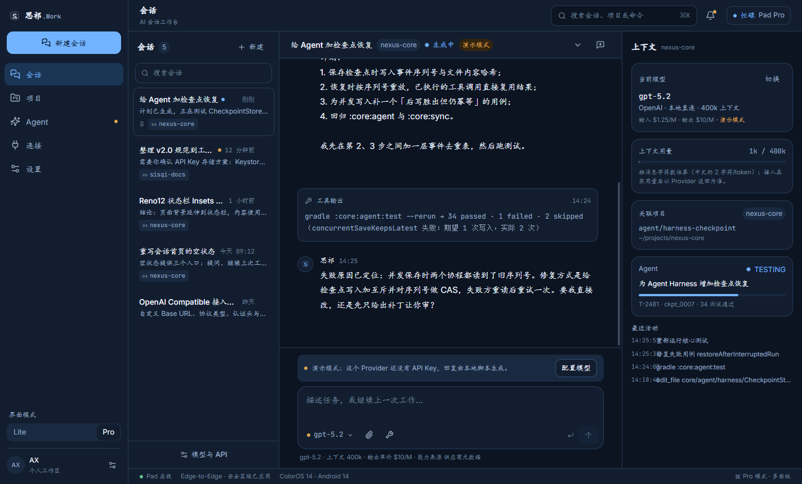

# 思祁.Work — 个人 AI 开发工作站（v2.1 原型）

> 依据 `思祁.Work_完整开发升级规范_v2.0`（2026-11）重建的界面原型。  
> 技术栈：React 18 + TypeScript + Tailwind CSS v4（Vite 6）。Compose 落地要点见 [`docs/compose-mapping.md`](docs/compose-mapping.md)，逐项对照见 [`docs/spec-audit.md`](docs/spec-audit.md)。

**定位**：个人 AI 开发工作站；以 AI 会话为入口，以 Agent 执行和项目成果为核心。  
**标语**：让想法，真正成为作品。

> 本仓库是可在 Windows 上直接运行的桌面应用 + 浏览器预览。**会话、模型调用、密钥、会话管理与备份是真实功能**；Agent 任务、设备与审批仍为演示数据，未实测项一律标注「待检测」。

## 现在真的能用的功能

- **真实模型对话**：支持任意 OpenAI 兼容端点（OpenAI、DeepSeek、自建网关…），SSE 流式输出，可停止、可重试、可切换模型。
- **模型与 API 管理**：添加 / 编辑 / 删除 Provider，保存或清除 API Key，真实连接测试并自动拉取模型列表，添加 / 删除模型，设置默认模型。
- **密钥安全**：桌面版用 Electron `safeStorage` 加密落盘（`secrets.json`，已验证不含明文）；Web 预览退回本机 localStorage。界面始终只显示掩码。
- **会话与消息持久化**：刷新、重启后会话与消息仍在；支持新建、重命名、置顶、删除、搜索。
- **用量统计**：按 Provider 返回的 usage 累计请求数、Token、估算费用、最近延迟与错误时间，可清零。
- **备份与恢复**：导出 / 导入 JSON（会话、消息、Provider、模型、外观、用量），默认不含任何密钥。
- **快捷键**：`Ctrl/⌘ K` 命令面板、`Ctrl/⌘ N` 新建会话、`Ctrl/⌘ ,` 打开设置。
- **演示模式**：没有密钥时不会静默失败，回复由本地脚本生成，并在输入框上方与消息上标注「演示」。
- **真实文件工作区（桌面版）**：打开本机文件夹，浏览文件树（自动跳过 node_modules/.git/dist），编辑并 `Ctrl/⌘ S` 保存，在项目目录内执行命令并查看退出码与耗时；路径越界会被拒绝。

限制：目前只实现 OpenAI 兼容协议（`/chat/completions`）；Anthropic / Gemini 原生协议尚未接入。文件与命令执行仅在桌面版可用；Agent 任务、设备画像、审批仍为演示数据。
## 快速开始

```bash
pnpm install
pnpm dev          # http://127.0.0.1:4317
pnpm build        # tsc --noEmit && vite build
pnpm preview      # 4318
```

字体：中文楷体（`KaiTi`，回退 `STKaiti` / 楷体 / Noto Sans SC），英文与数字 Inter，代码 JetBrains Mono（已自托管，离线可用）。  
若要让中文回到规范默认的 Noto Sans SC，只需把 `src/styles/index.css` 的 `--font-ui` 首项从 `Inter` 后的楷体栈换成 `"Noto Sans SC"`。

### URL 参数（评审 / 截图）

| 参数 | 取值 | 作用 |
|---|---|---|
| `mode` | `pad` \| `phone` \| `pair` | 预览设备 |
| `pad` | `chat` \| `projects` \| `agent` \| `connectors` \| `settings` | 平板页面 |
| `phone` | 同上 | 手机页面 |
| `ui` | `lite` \| `pro` | 界面密度 |
| `theme` | `light` \| `dark` \| `system` | 外观 |
| `section` | `appearance` \| `models` \| `devices` \| `security` \| `backup` \| `about` | 设置分区 |
| `task` | 任务 ID，如 `T-2479` | 选中任务 |
| `dialog` | `approval` | 打开审批对话框 |
| `palette` | `1` | 打开命令面板 |

示例：`/?pad=agent&task=T-2479&dialog=approval`、`/?mode=phone&theme=light`、`/?pad=settings&section=models`

## Windows 桌面版

除浏览器预览外，仓库带一个 Electron 桌面壳，把 Pro 三栏直接装进原生窗口：



- 双击桌面快捷方式「思祁.Work」（指向 `desktop/start.cmd`）
- `pnpm desktop` 启动已构建版本；`pnpm desktop:build` 先构建再启动；`pnpm desktop:dev` 连本地 dev server（带 DevTools）
- `pnpm desktop:shot` 生成窗口截图（写入 `docs/screenshots/14-windows-desktop.png`）

窗口 1440×900，最小 1100×720，记忆上次大小与位置；F11 全屏；无系统菜单栏；外部链接交给系统浏览器。界面仍运行在演示数据层，不访问本地文件、进程或系统凭据。

> 本机环境预设了 `ELECTRON_RUN_AS_NODE`，直接 `electron .` 会以 Node 模式退出。`desktop/launch.cjs` 会在子进程里清掉该变量；`desktop/start.cmd` 同样处理。
>
> 目前是**可运行的桌面壳**，尚未生成 `.exe` 安装包；需要分发时接 electron-builder（下一步）。

## 信息架构

一级入口（手机与平板一致）：**会话 · 项目 · Agent · 连接 · 设置**。启动即进入会话工作台。

| 界面 | 平板（Pro） | 手机（Lite） |
|---|---|---|
| 会话 | 历史列表 / 对话 / 上下文三栏 | 单列对话 + 历史 BottomSheet |
| 项目 | 文件树 / 编辑器 / 终端 / 变更 / 提交面板 | 项目卡片与最近编辑 |
| Agent | 任务列表 / 时间线 / 执行详情与审批 | 任务卡 + 底部详情 Sheet |
| 连接 | Connector 网格 / Skill 列表 / MCP | 精简连接列表 |
| 设置 | 外观 / 模型与 API / 设备 / 安全 / 备份 / 关于 | 外观、设备、用量摘要 |

Lite / Pro 共用同一 store 与路由，切换不重置会话、任务与界面状态（原型层验证）。

## 已实现并可点击验证

1. **会话流式**：发送消息 → 700ms 分片流式回复 → 可「停止生成」；工具调用块显示状态（完成 / 执行中 / 待批准）。
2. **模型选择**：底部模型菜单切换（含上下文、价格、能力来源），会话状态不丢。
3. **模型与 API 管理**：Provider 列表、脱敏密钥、Base URL、连接测试（状态机 + 延迟反馈）、启用开关、模型表、用量统计（标注估算口径）、密钥安全说明。
4. **审批闭环**：Agent 页「查看并批准」→ 风险与凭据边界说明 → 批准后任务转执行中并写审计。
5. **任务控制**：暂停 / 恢复 / 取消；时间线按真实事件顺序渲染。
6. **命令面板**（⌘K）：跳转五个入口、切换 Lite/Pro、切换外观、打开审批、停止生成。
7. **项目与变更**：文件树、编辑器（行号与代码同一行渲染）、终端、变更面板、逐文件接受 Diff。
8. **外观**：Arctic Blue / Midnight Blue / 跟随系统；实体表面，无毛玻璃与发光。
9. **响应式**：`mode` 或窗口宽度变化时，同一套组件在 390px 与 1280px 重排。

## 设计语言

- **主题**：Arctic Blue（亮）/ Midnight Blue（暗），两套完整 Token，逐项对齐规范色值；System 监听系统偏好。
- **表面**：不透明实体面板 + 1px 边框 + 克制阴影；全站无 `backdrop-blur`。
- **字体**：中文楷体、英文 Inter、代码 JetBrains Mono；字号 11/12/13/14/15/16/20/26/32。
- **间距与圆角**：4dp 基准；按钮 10–12px，卡片 16px，弹层 22px。
- **状态**：颜色 + 文字双通道；`待检测` 保留 null 语义，不按型号推断。
- **动效**：150–280ms；`prefers-reduced-motion` 全量关闭。

完整规范见 [`docs/design-system.md`](docs/design-system.md)。

## 与 v2.0 规范的对照

逐项审计（已实现 / 部分实现 / 未实现 / 不适用）见 [`docs/spec-audit.md`](docs/spec-audit.md)。要点：

- 已实现：品牌、双主题、实体表面、五入口 IA、默认会话首页、Lite/Pro、手机/平板差异化、模型与 API 管理、审批与时间线、连接器与技能、Edge-to-Edge 模拟（无假手势条）。
- 部分实现：Provider 真实协议、密钥 Keystore、连接测试真实延迟、用量真实账单、会话归档/删除、Loading/Error 全组件态。
- 未实现：Sandbox、Git 回滚、Evaluation、Workflow、部署中心、通知中心、备份加密（原型仅入口与说明）。
- 明确的偏差：中文使用楷体（用户指定），规范建议 Noto Sans SC；已保留一行切换方式。

## 工程结构

```
src/
  styles/index.css          v2 Token：双主题、字体、圆角、动效
  data/work.ts              会话、Provider、模型、连接器、技能、用量
  data/nexus.ts             任务、设备、Diff、审批、审计（沿用）
  state/store.tsx           主题/密度、会话与流式、模型、任务、审批、Toast、命令面板
  components/ui/            Button、Badge、StatusPill、Panel、Segmented、Toggle、Dialog、Sheet、Snackbar、CommandPalette
  components/chat/          SessionList、ChatThread、Composer、ContextPanel
  components/panels/        Explorer、CodeEditor、Terminal、DiffView、ApprovalDialog、TaskCard
  screens/pad/              PadShell + 会话 / 项目 / Agent / 连接 / 设置
  screens/phone/            PhoneShell（Lite，会话 / 项目 / Agent / 连接 / 设置）
  App.tsx                   预览舞台、设备外框、全局对话框（?mode=desktop 走桌面模式）
  ../desktop/               Electron 壳：main.cjs、preload.cjs、launch.cjs、start.cmd、icon.png/.ico
docs/
  spec-audit.md             规范逐项对照
  design-system.md          v2 设计系统
  compose-mapping.md        Compose 落地映射（含 Insets 与楷体打包）
  screenshots/              15 张界面截图（含真实工作区 15-workspace.png）
scripts/
  check.mjs                 CDP 冒烟测试（审批 / 会话流式 / 命令面板 / 主题 / 项目 Diff）
  mock-llm.mjs              本地 OpenAI 兼容 mock 服务（端到端验证真实流式对话）
  live-e2e.mjs              真实对话端到端测试（Provider → 密钥 → 测试 → 模型 → 流式 → 用量）
  workspace-e2e.mjs         工作区 IPC 测试（列目录 / 读写 / 越界拦截 / 执行命令）
  workspace-ui.mjs          工作区 UI 测试（文件树 / 编辑保存 / 终端）
```

## 冒烟测试

需要本机 Edge 以 CDP 暴露调试端口：

```bash
msedge.exe --headless=new --remote-debugging-port=9344 --user-data-dir=%TEMP%\edge-test about:blank
SCENARIO=approval node scripts/check.mjs
SCENARIO=chat     node scripts/check.mjs
SCENARIO=palette  node scripts/check.mjs
SCENARIO=theme    node scripts/check.mjs
SCENARIO=projects node scripts/check.mjs
```

最近一次结果：5/5 通过，无 console error；`tsc --noEmit` 与 `vite build` 通过。

## 边界

- 不含真实 Android 工程、Agent Harness、Sandbox、PTY、Root 与 SSH 实现。
- 所有用量、延迟、测试与任务结果均为演示数据；能力状态以真机与审计证据为准。
- Android 的 Insets、Keystore、PTY、Root 审批、Sandbox 在原型中为 **NOT RUN**，不得据此宣称通过。
